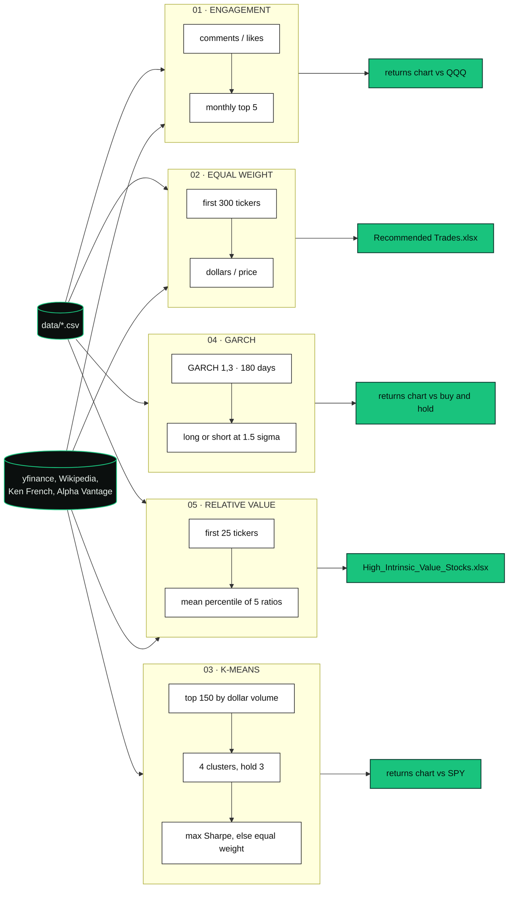
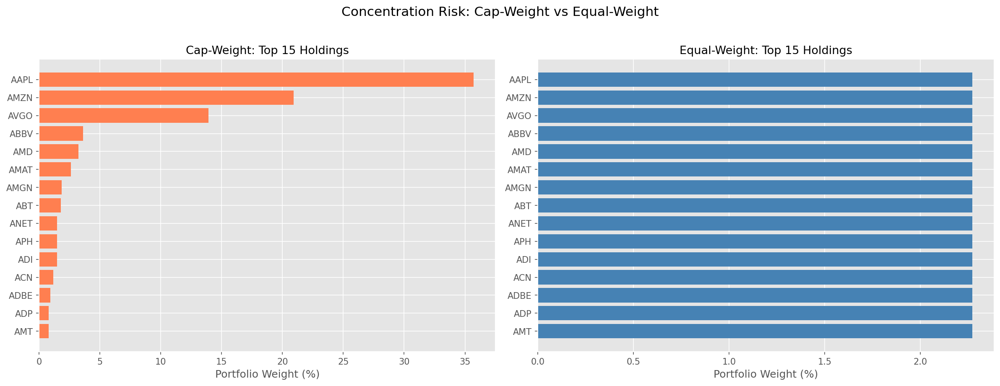
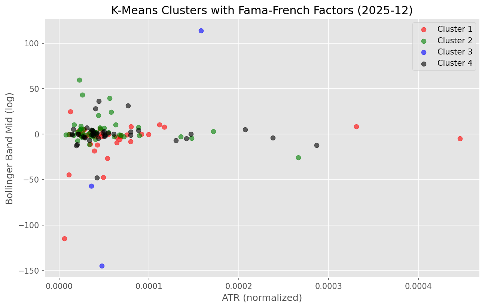

<p align="center">
  
  
  
  
  
  
  
  
</p>

**Five research strategies. No orders, no broker, no claimed track record.**

<sub>Twitter engagement ranks, equal-weight share counts, K-means on technicals, a GARCH(1,3) book on a simulated series, and a five-ratio value screen.</sub>

---

## ▍The problem

Cap-weight is a bet on size. The alternatives here are five separate Python scripts, each with a small rule and a committed artifact.

One ranks 85 names by Twitter comments over likes and compares them with QQQ. One prices the first 300 tickers in a constituent file and writes a share count. One clusters liquid S&P 500 names and holds cluster 3 against SPY. One fits GARCH(1,3) to a simulated daily series. One scores the first 25 tickers on five valuation ratios and writes a spreadsheet.

Nothing in this repo submits an order. Backtests are hypothetical, depend on data and assumptions, and do not include all real-world costs.

## ▍The pipeline at a glance

These are parallel scripts, not one system. Each path below is what that file actually does.



| Strategy | What the code decides | Benchmark in the chart | Committed artifact |
| --- | --- | --- | --- |
| **Engagement** | Monthly mean of `twitterComments / twitterLikes`, after ratio > 0.1 and likes and comments each > 20. Hold names with rank below 6. Ties can keep more than five. Equal-average their log returns. | QQQ | [`results/twitter_sentiment_returns.png`](results/twitter_sentiment_returns.png) |
| **Equal weight** | `position = portfolio value / N`, shares = position / last price. The script does not floor the share count. | None. The notebook draws cap-weight beside it. | [`output/Recommended Trades.xlsx`](output/Recommended%20Trades.xlsx) and two notebook charts |
| **K-means** | Four clusters each month. The portfolio is cluster id 3, hardcoded. Weights are max Sharpe on the prior 12 months (Ledoit-Wolf, bounds 0.001 to 1, solver SCS), or equal weight if that raises `ValueError`. | SPY | [`results/unsupervised_ml_returns.png`](results/unsupervised_ml_returns.png) |
| **K-means + factors** | Same holding rule, on 12 scaled features: 7 indicators plus 5 rolling betas. | SPY | [`results/fama_french_ml_returns.png`](results/fama_french_ml_returns.png), [`results/fama_french_clusters.png`](results/fama_french_clusters.png) |
| **GARCH(1,3)** | 180-day rolling fit on daily log returns of the simulated series. Long or short when the prediction premium is outside ±1.5 rolling standard deviations. Shift one day, then forward-fill. | Buy and hold of the same series | [`results/garch_volatility_returns.png`](results/garch_volatility_returns.png) |
| **Relative value** | Mean of percentile ranks of P/E, P/B, P/S, EV/EBITDA, and EV/GP. Lower score is cheaper. Share count is `floor(portfolio / 23 / price)` for every name that survived the fetch. | None. This is a screen, not a backtest. | [`output/High_Intrinsic_Value_Stocks.xlsx`](output/High_Intrinsic_Value_Stocks.xlsx), [`results/value_investing_rv_scores.png`](results/value_investing_rv_scores.png) |

**Engagement.** `data/sentiment_data.csv` has 27,235 rows, 85 symbols, from 2021-11-18 to 2023-01-04. Columns include `twitterSentiment` (22,995 rows filled). The strategy never reads that column. Rank is computed on month-end groups, then the index is shifted forward one day before prices are applied. Prices come from yfinance. The script compounds with `exp(cumsum)` of log returns. The notebook compounds with `exp(log1p(cumsum))` and writes the same PNG path, so a re-run can change the figure.

**Equal weight.** `data/sp_500_stocks.csv` lists 502 tickers and nothing else. The script takes the first 300, sleeps 0.5 seconds between yfinance calls, and asks for a portfolio value on stdin. The committed `Recommended Trades.xlsx` is one such run (267 priced names). `Recommended Diversified Trades For S&P500.xlsx` has the same four columns and different prices. No file in the repo writes that second name. The sector and concentration charts come from the notebook, which uses the first 50 tickers and a $100,000 example.

**K-means.** Both ML scripts download the current Wikipedia S&P 500 list and about 15 years of OHLCV ending today (`today - 365 * 15` days). Liquidity is the top 150 names by a 60-month average dollar volume. RSI (20-day), Bollinger Bands on `log1p(close)`, and ATR (14-day) come from pandas-ta. Garman-Klass volatility and the 12/26 MACD are computed in the script. RSI, ATR, and MACD are z-scored per name. Monthly returns are clipped at the 0.5% and 99.5% tails.

The script `unsupervised_ML_strat.py` clusters unscaled features and a 1-month return (`KMeans`, `k=4`, `init='random'`, `n_init=10`, `random_state=0`). It does not save a figure. The notebook adds 2, 3, 6, 9, and 12-month returns and clusters that frame. It writes `unsupervised_ml_returns.png`. The same notebook also downloads Fama-French factors and fits betas. Those betas are not the frame behind the chart.

**Factors.** Ken French's `F-F_Research_Data_5_Factors_2x3` via `pandas-datareader`. The file renames HML to VMG. The target is `return_1m - RF`. Betas are a 60-month rolling `LinearRegression(fit_intercept=False)` with at least 15 complete rows, then shifted one period before the join. Each month is `StandardScaler`'d and clustered with `init='k-means++'`. Cluster 3 is still the book. The factor notebook writes both factor charts. The script does not.

**GARCH.** `data/simulated_daily_data.csv` runs from 2014-09-17 to 2023-09-18. Adjusted close goes from 114.33 to 6,688.57. The fit uses that series only. `data/simulated_5min_data.csv` (177,877 bars, 2021-09-29 20:00 through 2023-09-20 11:00) is loaded in the notebook and never passed to `arch_model`. The script prints a metric table and saves the PNG. The notebook's saved output, on this simulated path and with no costs, is:

| | Total return | Annualized return | Annualized vol | Sharpe | Max drawdown | Win rate |
| --- | --- | --- | --- | --- | --- | --- |
| GARCH strategy | 79442.3% | 66.8% | 56.3% | 1.19 | −66.0% | 53.2% |
| Buy and hold | 5750.1% | 36.6% | 59.8% | 0.61 | −83.4% | 52.9% |

Sharpe in that cell is annualized return divided by annualized volatility. There is no risk-free rate. The buy-and-hold total matches the price change in the CSV. Treat the row as a description of this file, not of a traded book.

**Relative value.** Alpha Vantage `OVERVIEW` supplies P/E, P/B, P/S, EV/EBITDA, gross profit, shares, and market cap. yfinance supplies the last price, cash, and total debt. EV/GP is `(market cap + total debt - cash) / gross profit` when both market cap and gross profit are positive. The script sleeps 13 seconds between names. The notebook states that the free tier allows 25 requests a day and that the cell takes about five minutes. A committed run skipped ABC and ABMD on missing yfinance fields and kept 23 names. The divisor in the share-count formula stays 23 even if a later run keeps a different count.

## ▍The demo

Every image below is already in [`results/`](results/). Notes beside the files live in [`results/README.md`](results/README.md). Re-running a notebook overwrites the PNG. Live downloads will not reproduce a chart exactly.

<table>
<tr>
<td width="50%">

<br><b>01 · ENGAGEMENT.</b> Top 5 by monthly comments/likes, against QQQ. The figure runs from January 2022 to March 2023. The portfolio line finishes near zero. The Nasdaq line finishes near −30%. No Sharpe table is stored for this strategy.
</td>
<td width="50%">

<br><b>02 · SECTORS.</b> Notebook only. First 50 tickers. Equal-weight sector dollars beside cap-weight sector dollars.
</td>
</tr>
<tr>
<td width="50%">

<br><b>03 · CONCENTRATION.</b> Same 50-name slice. Per-name weight, equal-weight against cap-weight. This is not a full-index chart.
</td>
<td width="50%">

<br><b>04 · CLUSTER 3.</b> Notebook chart. Technical indicators plus lagged monthly returns. Cluster id 3 against SPY. Factor betas are a different chart.
</td>
</tr>
<tr>
<td width="50%">

<br><b>05 · FACTOR CLUSTERS.</b> Latest month in the factor notebook. Four clusters on the scaled 12-feature set.
</td>
<td width="50%">

<br><b>06 · FACTOR BOOK.</b> Cluster 3 again, this time with the five rolling betas in the feature set, against SPY.
</td>
</tr>
<tr>
<td width="50%">

<br><b>07 · GARCH.</b> Simulated daily series, 2014–2023. The vertical scale is large because the series itself is. Numbers are the notebook output above.
</td>
<td width="50%">

<br><b>08 · RV SCORE.</b> Percentile heatmap for the screened names. Lower composite score is cheaper. Not a return series.
</td>
</tr>
</table>

## ▍Run it

Python 3 and the packages in [`requirements.txt`](requirements.txt). Jupyter is not in that file. The notebooks need a notebook client you install yourself. There is no test suite.

```sh
git clone https://github.com/bede-lau/Algorithmic_Trading_Strategies.git
cd Algorithmic_Trading_Strategies
python -m venv venv
source venv/bin/activate          # Windows: venv\Scripts\activate
pip install -r requirements.txt
```

**Key policy.** One key, one script. Copy [`.env.example`](.env.example) to `.env` and set `ALPHA_VANTAGE_API_KEY`. Only the value screener reads it. Do not commit `.env`. GARCH reads the committed CSV and needs no key. The other strategies call yfinance, and the ML scripts also call Wikipedia. The factor script also calls Ken French's library through `pandas-datareader`.

```sh
# Local CSV + yfinance prices. Writes results/twitter_sentiment_returns.png, then plt.show().
python strategies/twitter_sentiment/Twitter_sentiment_analysis.py

# Asks for a portfolio value. Writes output/Recommended Trades.xlsx.
# 300 names, 0.5s pause each.
python strategies/equal_weight_sp500/equal-weighted_spx500_strategy.py

# Wikipedia constituents, ~15 years of prices. Several minutes. Does not save a PNG.
python strategies/unsupervised_ml/unsupervised_ML_strat.py

# Same, plus Ken French betas. Quote the plus sign. Does not save a PNG.
python "strategies/unsupervised_ml/unsupervised_ML_strat+FamaFrenchFactors.py"

# Local simulated daily CSV. Several minutes. Prints metrics, writes the GARCH PNG, then plt.show().
python strategies/garch_volatility/GARCH_model_strategy.py

# Needs ALPHA_VANTAGE_API_KEY. Asks for a portfolio value.
# First 25 tickers, 13s pause each. Writes output/High_Intrinsic_Value_Stocks.xlsx.
python strategies/value_investing/lowest_ratios_value_investing_strategy.py
```

`plt.show()` waits on a window. For a file-only GARCH or Twitter run, set `MPLBACKEND=Agg` in the environment before the script.

Notebooks that write the other PNGs:

| Notebook | Writes |
| --- | --- |
| [`strategies/twitter_sentiment/Twitter_notebook.ipynb`](strategies/twitter_sentiment/Twitter_notebook.ipynb) | `results/twitter_sentiment_returns.png` |
| [`strategies/equal_weight_sp500/equal_weight_notebook.ipynb`](strategies/equal_weight_sp500/equal_weight_notebook.ipynb) | `equal_weight_sector_allocation.png`, `equal_weight_concentration.png` |
| [`strategies/unsupervised_ml/unsupervised_ML_notebook.ipynb`](strategies/unsupervised_ml/unsupervised_ML_notebook.ipynb) | `unsupervised_ml_returns.png` |
| [`strategies/unsupervised_ml/unsupervised_ML+FamaFrench_notebook.ipynb`](strategies/unsupervised_ml/unsupervised_ML+FamaFrench_notebook.ipynb) | `fama_french_clusters.png`, `fama_french_ml_returns.png` |
| [`strategies/garch_volatility/GARCH_notebook.ipynb`](strategies/garch_volatility/GARCH_notebook.ipynb) | `garch_volatility_returns.png` |
| [`strategies/value_investing/value_investing_notebook.ipynb`](strategies/value_investing/value_investing_notebook.ipynb) | `value_investing_rv_scores.png` |

## ▍Repository map

```
Algorithmic_Trading_Strategies/
├── strategies/
│   ├── twitter_sentiment/
│   │   ├── Twitter_sentiment_analysis.py
│   │   └── Twitter_notebook.ipynb
│   ├── equal_weight_sp500/
│   │   ├── equal-weighted_spx500_strategy.py
│   │   └── equal_weight_notebook.ipynb
│   ├── unsupervised_ml/
│   │   ├── unsupervised_ML_strat.py
│   │   ├── unsupervised_ML_strat+FamaFrenchFactors.py
│   │   ├── unsupervised_ML_notebook.ipynb
│   │   └── unsupervised_ML+FamaFrench_notebook.ipynb
│   ├── garch_volatility/
│   │   ├── GARCH_model_strategy.py
│   │   └── GARCH_notebook.ipynb
│   └── value_investing/
│       ├── lowest_ratios_value_investing_strategy.py
│       └── value_investing_notebook.ipynb
├── data/
│   ├── sentiment_data.csv          85 symbols, 2021-11-18 to 2023-01-04
│   ├── sp_500_stocks.csv           502 tickers
│   ├── simulated_daily_data.csv    2014-09-17 to 2023-09-18
│   └── simulated_5min_data.csv     loaded in the GARCH notebook, not fitted
├── output/                         Excel snapshots from earlier runs
├── results/                        charts and results/README.md
├── requirements.txt
├── .env.example
└── LICENSE
```

| Doc | |
| --- | --- |
| [results/README.md](results/README.md) | One note per chart |
| [.env.example](.env.example) | `ALPHA_VANTAGE_API_KEY` placeholder |
| [LICENSE](LICENSE) | MIT. Copyright (c) 2024 bedel |

## ▍What this is, and isn't

We'd rather be precise than impressive.

- This is research code. It is not financial advice. Past plots are not a forecast.
- No script sends an order. There is no broker adapter, no cost model, and no slippage model.
- The engagement file is a committed CSV. The code comment calls the names NASDAQ stocks. The signal is comments/likes. The `twitterSentiment` column is unused. Nothing here runs FinBERT or any other text model.
- Cluster id 3 is a fixed label. The code does not pick the cluster with the best return. `k` is 4. There is no silhouette search.
- The ML universe is today's Wikipedia S&P 500, pulled at runtime. That is survivorship relative to a historical index. The 15-year window ends on the day you run it, so the committed charts are one past run.
- The base ML script, the base notebook, and the factor script do not cluster the same columns. The returns PNG next to "unsupervised" is the notebook's technical-and-lag run.
- ML and the Twitter notebook compound with `exp(log1p(cumsum))` on series that are already log returns. The GARCH path and the Twitter script use `exp(cumsum) - 1`.
- GARCH is fit to `simulated_daily_data.csv`. The 5-minute file is not an input to the model. The printed returns describe that simulated path.
- The value screener is a point-in-time rank of the first 25 tickers, not a historical backtest. EV/GP needs cash, debt, and gross profit. Names missing those fields are dropped.
- The equal-weight charts are the first 50 names. The script trades up to the first 300. Neither is the full file of 502.
- Not in the repo: GJR-GARCH, walk-forward splits, stop-losses, drawdown limits, or a stored table of Sharpe ratios for the equity strategies. The GARCH notebook output is the only saved metric table.

## ▍Credits

| | |
| --- | --- |
| Prices | [yfinance](https://github.com/ranaroussi/yfinance) |
| Engagement file | `data/sentiment_data.csv`, committed with the repo. Vendor is not documented here. |
| Constituents | `data/sp_500_stocks.csv`. ML scripts also read the live [Wikipedia S&P 500 list](https://en.wikipedia.org/wiki/List_of_S%26P_500_companies). |
| Factors | [Ken French data library](https://mba.tuck.dartmouth.edu/pages/faculty/ken.french/data_library.html), dataset `F-F_Research_Data_5_Factors_2x3`, through `pandas-datareader` |
| Fundamentals | [Alpha Vantage](https://www.alphavantage.co/) `OVERVIEW` |
| Volatility | [`arch`](https://github.com/bashtage/arch) |
| Optimizer | [PyPortfolioOpt](https://github.com/PyPortfolio/PyPortfolioOpt) |
| Indicators | [pandas-ta](https://github.com/twopirllc/pandas-ta) |
| License | [MIT](LICENSE). Copyright (c) 2024 bedel. |

<p align="center"><sub>Research code. Hypothetical results. MIT.</sub></p>
