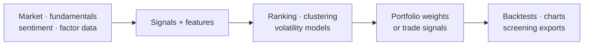
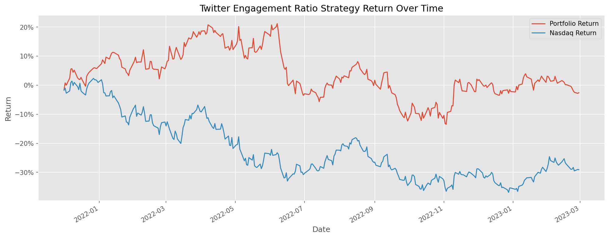
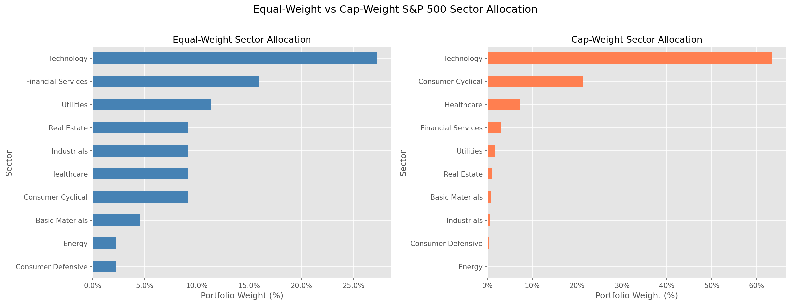
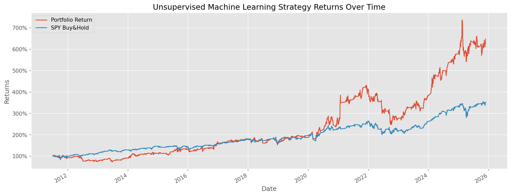
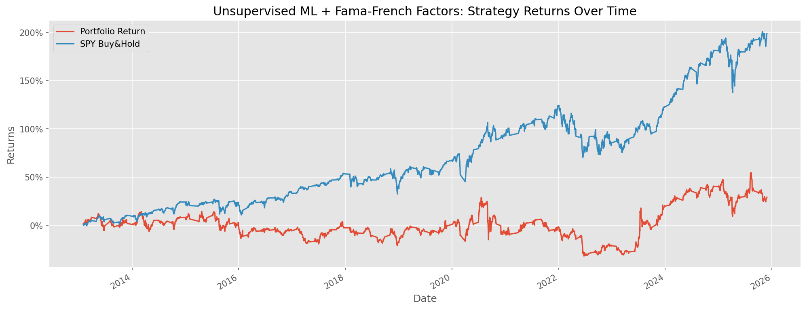
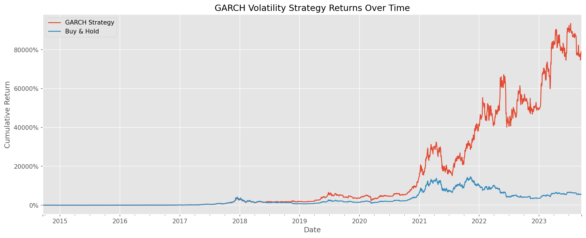
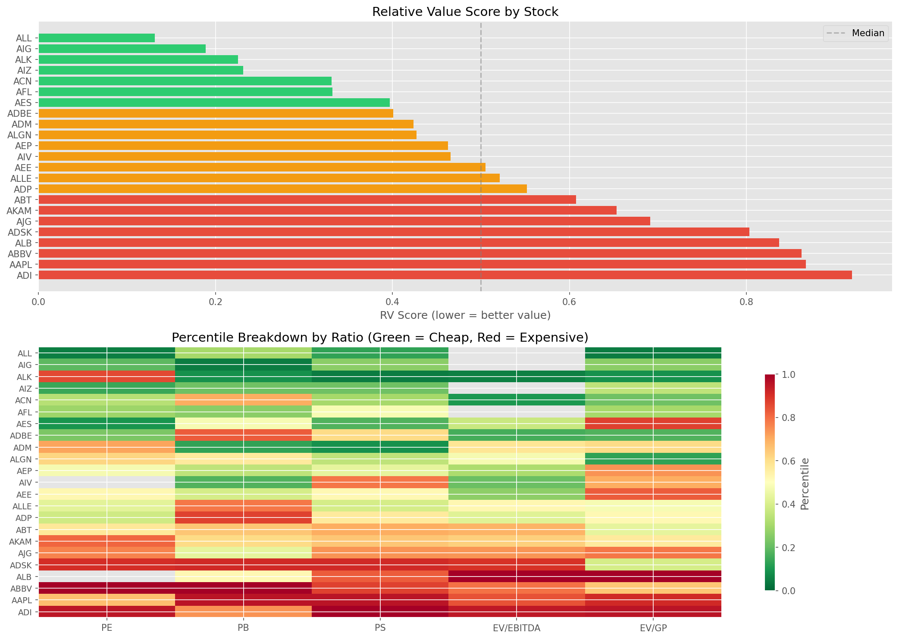

<h1 align="center">Algorithmic Trading Strategies</h1>
<p align="center"><b>Five research workflows, from signals and forecasts to portfolio construction.</b></p>

## ▍At a glance



Backtests are hypothetical, depend on data and assumptions, and do not include all real-world costs.

---

A collection of quantitative trading strategies implemented in Python, spanning social media sentiment analysis, equal-weight portfolio construction, unsupervised machine learning with factor models, volatility forecasting, and fundamental value screening.

## Strategies

### 1. Twitter Sentiment Analysis Strategy

Ranks NASDAQ stocks monthly by Twitter engagement ratio (comments/likes) and constructs an equally-weighted portfolio of the top 5 highest-engagement stocks. Compares cumulative returns against QQQ (Nasdaq-100 ETF).

**Approach:**
- Calculate engagement ratio = twitterComments / twitterLikes
- Filter for genuine engagement (ratio > 0.1, likes > 20, comments > 20)
- Monthly rebalancing with top 5 ranked stocks
- Log returns compared to Nasdaq benchmark

**Files:** [`strategies/twitter_sentiment/`](strategies/twitter_sentiment/)



---

### 2. Equal-Weighted S&P 500 Portfolio

Portfolio construction tool that creates an equal-weight allocation across S&P 500 stocks. Given a portfolio size, calculates the number of shares to buy for each stock and exports a formatted Excel spreadsheet.

Academic research shows equal-weight S&P 500 outperformed cap-weight by ~1.5% annually (2003-2022) due to small-cap tilt and contrarian rebalancing effects.

**Files:** [`strategies/equal_weight_sp500/`](strategies/equal_weight_sp500/)



---

### 3. Unsupervised ML Clustering Strategy

Uses K-Means clustering on technical indicators to group S&P 500 stocks into 4 clusters monthly, then constructs an optimized portfolio from the best-performing cluster.

**Technical Indicators:** Garman-Klass Volatility, RSI (20-day), Bollinger Bands, ATR (14-day), MACD (12/26 EMA)

**Enhanced Version** adds Fama-French 5-factor rolling betas (Mkt-RF, SMB, VMG, RMW, CMA) as additional clustering features via 60-month rolling OLS regression.

**Portfolio Optimization:** Max Sharpe Ratio via Efficient Frontier with Ledoit-Wolf covariance shrinkage. Falls back to equal-weighting when optimization fails.

**Benchmark:** SPY (S&P 500 ETF) Buy & Hold

**Files:** [`strategies/unsupervised_ml/`](strategies/unsupervised_ml/)




---

### 4. GARCH Volatility Forecasting

Predicts 1-day-ahead volatility using a GARCH(1,3) model with 180-day rolling windows. Generates long/short trading signals when the prediction premium (forecasted vs realized variance) exceeds 1.5 standard deviations. Positions are held until a new signal is generated.

**Approach:**
- Fit GARCH(1,3) on rolling 180-day windows of daily log returns
- Calculate prediction premium = (forecasted variance - realized variance) / realized variance
- Long when premium > 1.5 * rolling std, short when premium < -1.5 * rolling std
- Forward-fill signals to maintain positions between signal changes

**Benchmark:** Buy & Hold

**Files:** [`strategies/garch_volatility/`](strategies/garch_volatility/)



---

### 5. Value Investing Screener

Screens S&P 500 stocks using a composite Relative Value (RV) Score derived from fundamental ratios: P/E, P/B, P/S, EV/EBITDA, and EV/GP. Ranks stocks by percentile across all ratios and calculates position sizes for a given portfolio.

**Data Sources:** Alpha Vantage API (fundamentals) + yfinance (prices, balance sheet)

**Files:** [`strategies/value_investing/`](strategies/value_investing/)



---

## Performance Summary

| Strategy | Period | Annualized Return | Sharpe Ratio | Max Drawdown | Benchmark |
|----------|--------|-------------------|--------------|--------------|-----------|
| Twitter Sentiment | 2022-2023 | Outperformed QQQ | — | — | QQQ (Nasdaq-100) |
| Unsupervised ML | 15 years | — | — | — | SPY |
| Unsupervised ML + Fama-French | 15 years | — | — | — | SPY |
| GARCH Volatility | 2014-2023 | — | — | — | Buy & Hold |

> Run each notebook to generate exact metrics. Results depend on data download timing and market conditions.
> Backtest results are hypothetical and do not account for transaction costs or slippage.

---

## Project Structure

```
├── strategies/
│   ├── twitter_sentiment/        # Sentiment-based stock selection
│   ├── equal_weight_sp500/       # Equal-weight portfolio construction
│   ├── unsupervised_ml/          # ML clustering + factor models
│   ├── garch_volatility/         # Volatility forecasting
│   └── value_investing/          # Fundamental ratio screening
├── data/                         # Input data (CSVs)
├── output/                       # Generated Excel reports
├── results/                      # Strategy performance charts
├── requirements.txt
└── LICENSE
```

## Installation & Usage

```bash
# Clone the repository
git clone https://github.com/bede-lau/Algorithmic_Trading_Strategies.git
cd Algorithmic_Trading_Strategies

# Create virtual environment
python -m venv venv
source venv/bin/activate  # or venv\Scripts\activate on Windows

# Install dependencies
pip install -r requirements.txt
```

**Run a strategy:**
```bash
# Twitter Sentiment (generates comparison chart)
python strategies/twitter_sentiment/Twitter_sentiment_analysis.py

# Equal-Weight S&P 500 (interactive - prompts for portfolio size)
python strategies/equal_weight_sp500/equal-weighted_spx500_strategy.py

# Unsupervised ML (downloads 15 years of data, takes several minutes)
python strategies/unsupervised_ml/unsupervised_machine_learning_strat.py

# GARCH Volatility (fits rolling models, takes several minutes)
python strategies/garch_volatility/GARCH_model_strategy.py

# Value Investing (requires Alpha Vantage API key, rate-limited)
python strategies/value_investing/lowest_ratios_value_investing_strategy.py
```

**Jupyter Notebooks** provide interactive exploration with visualizations:
- `strategies/twitter_sentiment/Twitter_notebook.ipynb`
- `strategies/equal_weight_sp500/equal_weight_notebook.ipynb`
- `strategies/unsupervised_ml/unsupervised_notebook.ipynb`
- `strategies/unsupervised_ml/unsupervised_FamaFrench_notebook.ipynb`
- `strategies/garch_volatility/GARCH_notebook.ipynb`
- `strategies/value_investing/value_investing_notebook.ipynb`

## Data Sources

| Source | Usage | Access |
|--------|-------|--------|
| Yahoo Finance (yfinance) | Historical OHLCV data | Free API |
| Twitter Sentiment Data | Engagement metrics for ~85 NASDAQ stocks | Included CSV |
| Fama-French 5 Factors | Factor returns (Mkt-RF, SMB, HML, RMW, CMA) | FRED via pandas-datareader |
| Alpha Vantage | Fundamental ratios (P/E, P/B, EV/EBITDA) | Free API key required |
| S&P 500 Constituents | Ticker list | Included CSV + Wikipedia |

## Future Enhancements

- **NLP Sentiment Scoring** — Replace engagement ratio with FinBERT/LLM-based sentiment classification
- **GJR-GARCH** — Asymmetric volatility model to capture the leverage effect in equities
- **Walk-Forward Backtesting** — Rolling train/test splits to reduce overfitting
- **Transaction Cost Modeling** — Realistic slippage and commission estimates
- **Silhouette Analysis** — Data-driven optimal cluster count for K-Means
- **Risk Management** — Stop-loss rules, position sizing, drawdown limits
- **Extended Backtest Periods** — Longer sentiment data windows, out-of-sample testing

## Disclaimer

This project is for **educational and research purposes only**. It does not constitute financial advice. Past performance does not guarantee future results. Backtest results may be subject to survivorship bias, look-ahead bias, and other methodological limitations. Always conduct your own due diligence before making investment decisions.

## License

[MIT](LICENSE)
