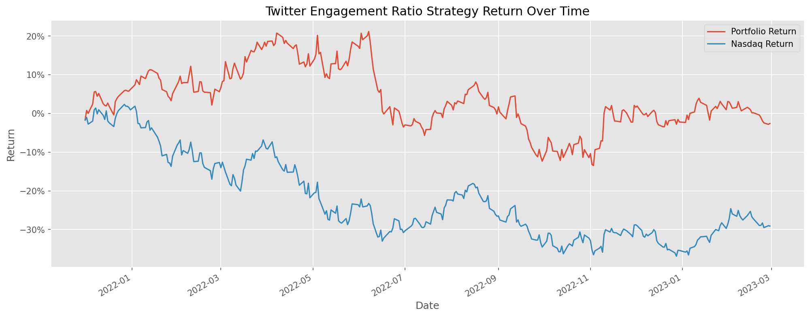
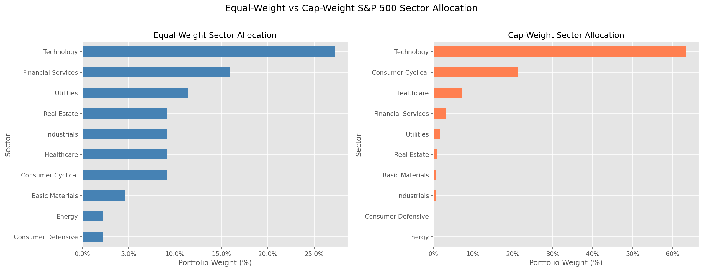
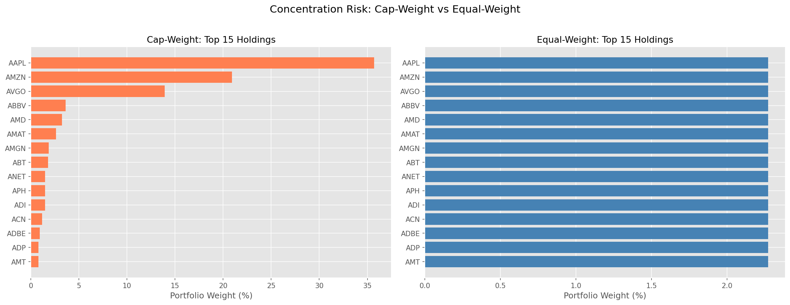
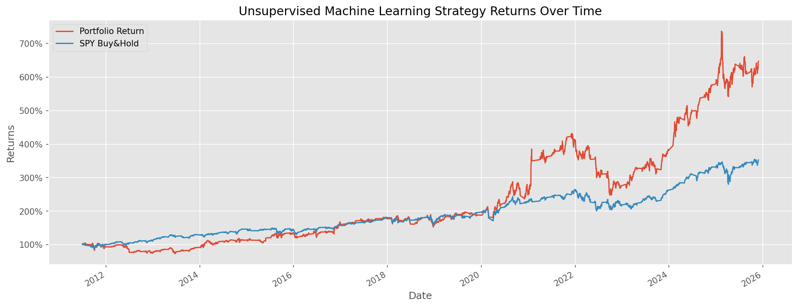
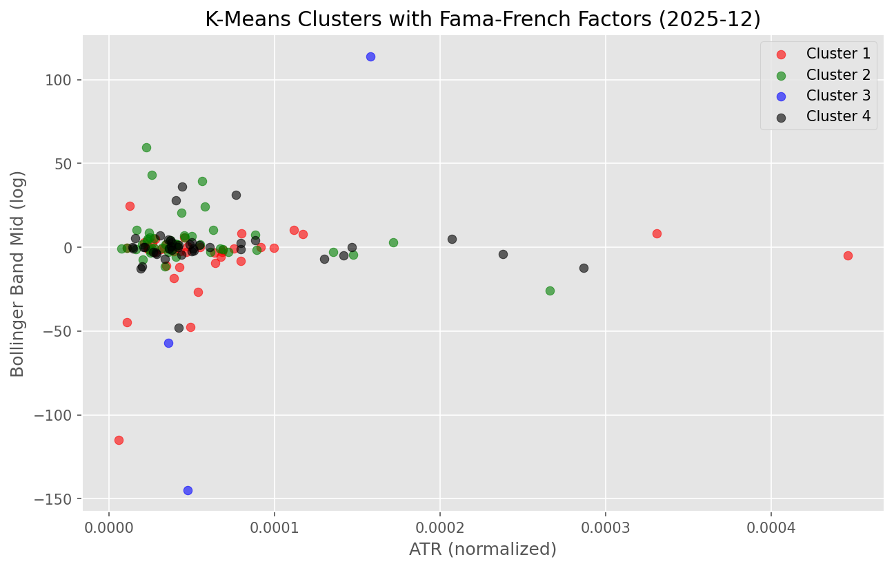
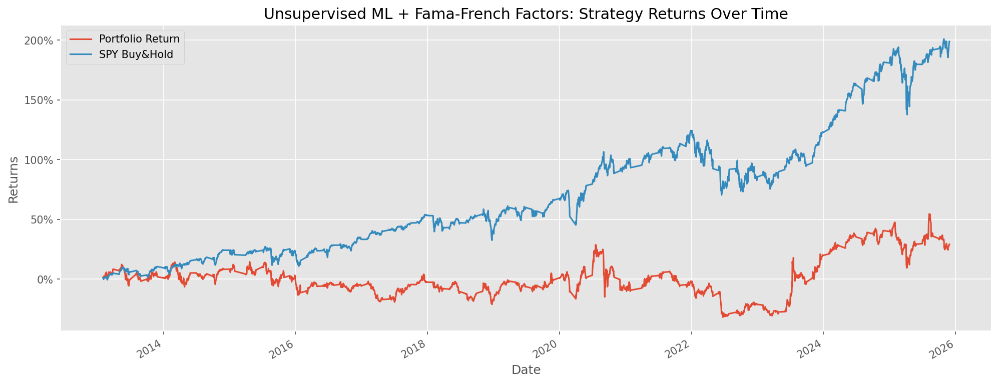
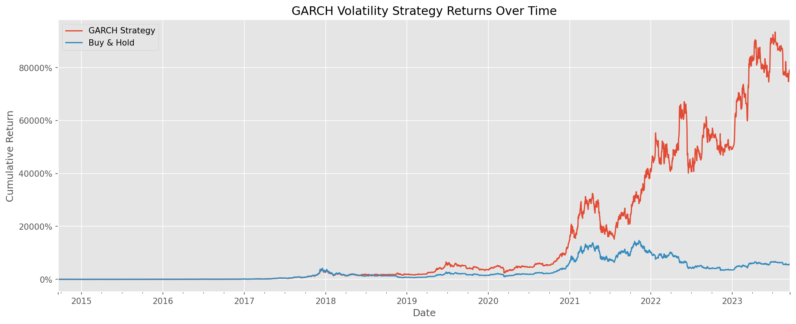
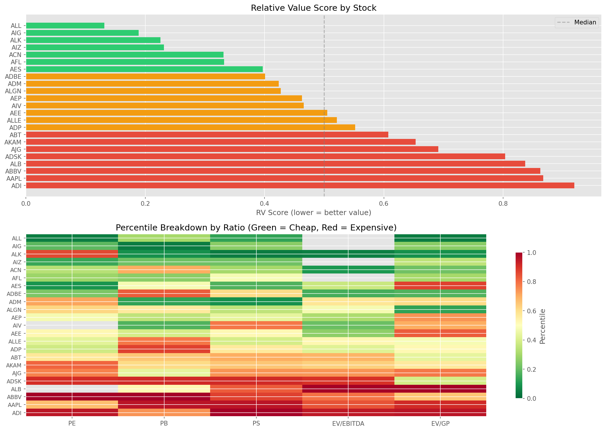

# Strategy Results

Charts generated by running the Jupyter notebooks in each strategy folder.

---

### Twitter Sentiment Returns

**Strategy:** Monthly portfolio of the top 5 NASDAQ stocks ranked by Twitter engagement ratio (comments/likes). Compared against QQQ (Nasdaq-100 ETF) buy-and-hold.

**Key takeaway:** The sentiment-based portfolio significantly outperformed the Nasdaq during 2022's tech selloff, demonstrating that high-engagement stocks (those generating genuine discussion) can offer downside protection relative to the cap-weighted index.

---

### Equal-Weight Sector Allocation

**Strategy:** Equal-weight portfolio construction across S&P 500 stocks vs cap-weighted allocation.

**Key takeaway:** Cap-weighting concentrates heavily in Technology (~30%+), while equal-weighting distributes exposure more evenly across sectors — reducing single-sector risk.

---

### Equal-Weight Concentration Risk

**Strategy:** Comparison of individual stock weights between cap-weighted and equal-weighted approaches.

**Key takeaway:** In cap-weighted portfolios, the top 5 stocks (Apple, Microsoft, etc.) can represent 20%+ of the portfolio. Equal-weighting caps each stock at ~0.2%, dramatically reducing concentration risk.

---

### Unsupervised ML Returns

**Strategy:** K-Means clustering (4 clusters) on 7 technical indicators for 150 most liquid S&P 500 stocks. Portfolio constructed from best-performing cluster with Max Sharpe Ratio optimization. Compared against SPY buy-and-hold.

**Key takeaway:** The ML-driven stock selection and portfolio optimization aims to identify regimes where certain stock characteristics cluster together, potentially capturing momentum and mean-reversion patterns.

---

### Fama-French ML Clusters

**Strategy:** Enhanced K-Means clustering using 12 features: 7 technical indicators + 5 Fama-French factor betas (Mkt-RF, SMB, VMG, RMW, CMA) estimated via 60-month rolling OLS regression.

**Key takeaway:** Adding factor betas provides a richer feature space for clustering, separating stocks by both their technical behavior and their fundamental factor exposures.

---

### Fama-French ML Returns

**Strategy:** Same as base unsupervised ML strategy but with Fama-French 5-factor rolling betas as additional clustering features. Monthly rebalancing with Max Sharpe optimization.

**Key takeaway:** Incorporating factor model betas adds fundamental context to the purely technical clustering, potentially improving cluster quality and portfolio selection.

---

### GARCH Volatility Strategy Returns

**Strategy:** GARCH(1,3) model fitted on 180-day rolling windows of daily log returns. Forecasts 1-day-ahead variance and compares to realized 180-day rolling variance. The "prediction premium" measures the divergence between forecasted and realized volatility. Long signals are generated when the premium exceeds 1.5 standard deviations above its rolling mean; short signals when below -1.5 standard deviations. Positions are forward-filled (held until a new signal).

**X-axis:** Date (backtest period from simulated daily data, 2014-2023)
**Y-axis:** Cumulative return (percentage)

**Methodology:**
- `prediction_premium = (GARCH_forecast - realized_variance) / realized_variance`
- `signal = +1` (long) when premium > 1.5 * rolling_std
- `signal = -1` (short) when premium < -1.5 * rolling_std
- `strategy_return = position * daily_log_return`

**Key takeaway:** The GARCH model exploits volatility mean-reversion — when forecasted volatility significantly exceeds realized volatility, the model expects a regime shift and positions accordingly. The strategy's value lies in risk-adjusted returns and drawdown reduction compared to passive buy-and-hold.

---

### Value Investing RV Scores

**Strategy:** Composite Relative Value (RV) Score derived from percentile rankings of P/E, P/B, P/S, EV/EBITDA, and EV/GP ratios. Lower score = more undervalued.

**Key takeaway:** The heatmap reveals which specific valuation metrics make each stock appear cheap or expensive, enabling targeted value investing decisions rather than relying on a single ratio.
